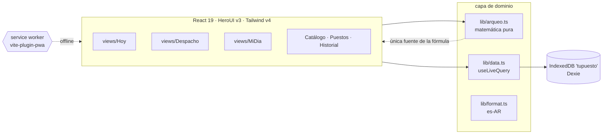
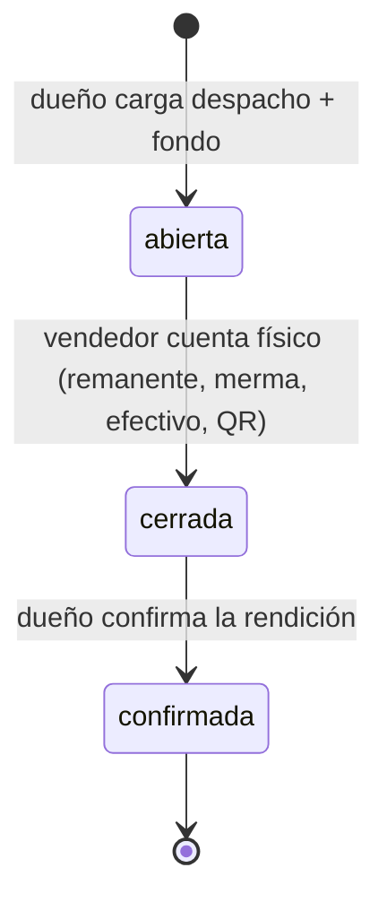

**TuPuesto** · Documentación técnica

> Cómo está armada la app. Para el *qué se construye y por qué*:
> `decisions.md` (ADR-001) y `RULES.MD`.

---

## Arquitectura

PWA **local-first**. Hoy corre todo en un solo dispositivo: los datos viven en
IndexedDB y el mismo celular alterna rol dueño/vendedor para la demo.
El modelo ya está pensado para sync multi-dispositivo — las jornadas son
documentos autónomos; agregar backend es mapear tablas 1:1 + auth por rol,
no rediseñar.



## Ciclo de vida de la jornada



Quién escribe qué está lockeado por regla (R12): el dueño abre, el vendedor
cierra, el dueño confirma. No hay otro flujo.

## Modelo de datos — Dexie `tupuesto`

| Tabla | La escribe | Clave |
|---|---|---|
| `productos` | dueño | nombre, `precio` (ARS entero), activo, orden |
| `puestos` | dueño | nombre, ubicacion, `qrDestinoDefault` ∈ `negocio`/`vendedor` |
| `vendedores` | dueño | nombre, `puestoId`, activo |
| `jornadas` | dueño abre · vendedor cierra · dueño confirma | ver abajo |

`Jornada` = puesto + vendedor + `fecha` (YYYY-MM-DD):

- apertura: `fondoCaja`, `despacho: [{productoId, cantidad}]`
- `cierre`: `remanente[]`, `merma[]`, `efectivoContado`, `qrTotal`,
  `qrDestino`, `nota?`, `cerradaAt`
- índices: `fecha`, `puestoId`, `[fecha+puestoId]`, `[fecha+vendedorId]`

## El arqueo — `src/lib/arqueo.ts`

```ts
vendido(p)  = despacho(p) − remanente(p) − merma(p)   // nunca < 0
totalVentas = Σ vendido(p) × precio(p)
esperado    = fondoCaja + totalVentas                  // lo que debería haber
cobrado     = efectivoContado + qrTotal                // lo presentado
diferencia  = cobrado − esperado   // <0 faltante · >0 sobrante
```

Flags calculados, no guardados:

| Flag | Condición | Qué dice |
|---|---|---|
| `qrFueraDeCuenta` | `qrTotal > 0 && qrDestino === 'vendedor'` | cobros digitales en modo confianza |
| `qrEnCero` | `qrTotal === 0` | declaró $0 digital — contrastar vs. su promedio |
| merma anómala | `merma% > 2 × promedio cross-puesto` | la variable libre dejando firma |

## Vistas

| Vista | Rol | Hace |
|---|---|---|
| `Hoy` | dueño | rendición del día por puesto, barra efectivo/QR, confirmar |
| `Despacho` | dueño | crea jornada: fondo + mercadería por producto |
| `Catalogo` | dueño | productos y precios (el arqueo usa el vigente) |
| `Puestos` | dueño | puestos, vendedor asignado, destino QR default |
| `Historial` | dueño | ventas/semana, merma% por puesto, diferencias acumuladas |
| `MiDia` | vendedor | despacho read-only + cierre por conteo + preview en vivo |

Rol y vendedor en `localStorage` (`tp-rol`, `tp-vendedor`) — mecanismo de demo,
no auth real.

## Seed — `src/db.ts`

Determinista (mulberry32). Espeja la landing: Marcos/Feria Central cierra OK,
Alejandra/Plaza Italia con faltante $16.400 y merma 18u, Diego/Costanera
abierto. 4 semanas de historial con merma inflada en Plaza Italia para que la
anomalía salte en Historial.

## Comandos

```bash
cd app
npm run dev       # dev (SIN service worker)
npm run build     # tsc -b && vite build
npm run preview   # dist/ con SW — así se prueba offline
npm run lint      # oxlint
```

<details>
<summary><b>Camino a backend — pendiente, sin decidir</b></summary>

Requiere decisión del humano (ver "Reapertura" en ADR-001). El modelo ya
coopera: `jornadas` append-only por rol, conteo físico sin timestamps de
servidor críticos, estados monotónicos. Un sync Supabase/Firebase mapea las
tablas 1:1 y agrega auth por rol + `negocioId` en cada tabla. El tap-por-venta
opcional y el roadmap D (QR a cuenta del dueño) viven en el mismo lugar: afuera
del wedge hasta que haya evidencia del piloto.
</details>

---
<sub>Si el doc y el código difieren, el código miente o el doc envejeció — avisar.</sub>
