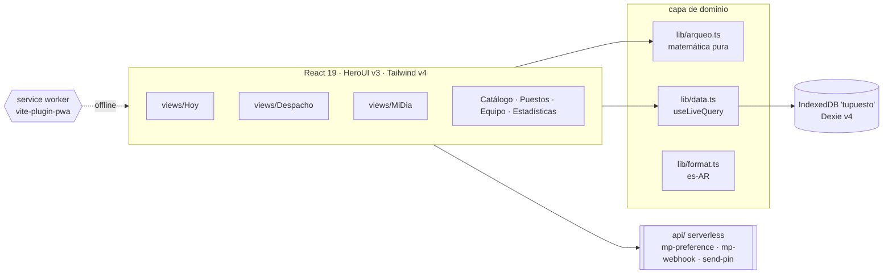
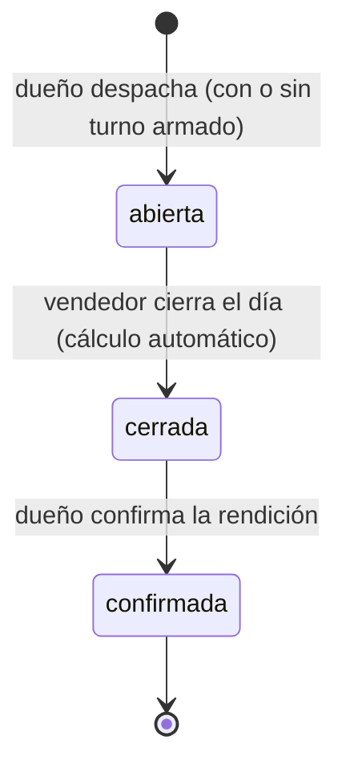

**TuPuesto** · Arquitectura

PWA **local-first**. Los datos viven en IndexedDB del dispositivo (Dexie);
no hay backend de datos todavía — solo `api/` serverless para cobros MP y
emails (Resend). El modelo coopera con sync futura: entidades autónomas,
mapeo 1:1 + auth por rol.

## Despacho vs. turno (ADR-002)

**Despacho** = productos → puesto (sin vendedor ni fondo). **Turno** =
vendedor + fondo de caja + confirmación del despacho — se arma en Hoy
(FAB `+`) o cuando el vendedor toma un despacho libre en MiDia. Multi-turno
por puesto/día: solo bloquea turnos `abierta` en el mismo puesto.

## Ciclo de vida de la jornada

Quién escribe qué (R12): el dueño abre/asigna, el vendedor vende y cierra,
el dueño confirma.
