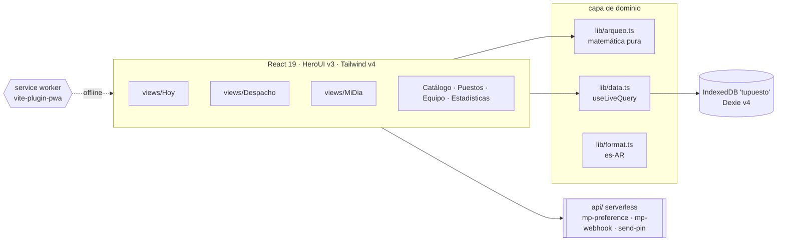
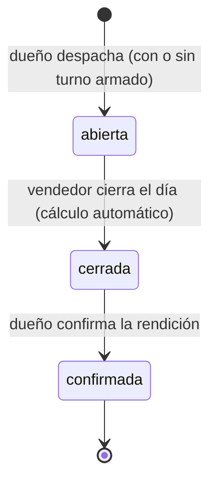

**TuPuesto** · Arquitectura

PWA con datos en IndexedDB del dispositivo (Dexie) — demo local hoy; el producto requiere internet (el dueño ve la rendición en tiempo real).
no hay backend de datos todavía — solo `api/` serverless para cobros MP y
emails (Resend). El modelo coopera con sync futura: entidades autónomas,
mapeo 1:1 + auth por rol.

## Despacho vs. turno (ADR-002)

**Despacho** = productos → puesto (sin vendedor ni fondo). **Turno** =
vendedor + fondo de caja + confirmación del despacho — se arma en Hoy
(FAB `+`) o cuando el vendedor toma un despacho libre en MiDia. Multi-turno
por puesto/día: solo bloquea turnos `abierta` en el mismo puesto.

## Ciclo de vida de la jornada

Quién escribe qué (R12): el dueño abre/asigna, el vendedor vende y cierra,
el dueño confirma.

## Backend — Neon Postgres + api/sync

- **DB**: Neon Postgres (7 tablas: `duenios`, `vendedores`, `puestos`, `productos`, `jornadas`, `ventas`, `solicitudes`) — snake_case, JSONB para despacho/reposiciones/saldo_inicial/descarte/cierre (jornadas) e items (ventas).
- **`api/sync.js`** (Vercel, proyecto landing): `GET` pull todas las tablas; `POST {tabla, rows}` upsert por `id` con whitelist de columnas por tabla. CORS abierto (la app vive en otro dominio).
- **`app/src/lib/sync.ts`**: `syncPull()` merge real (`put` por fila, la remota gana) + `startSyncLoop()` (pull inicial + interval 30s, llamado desde `main.tsx` post-seed). `syncPush(tabla, rows)` upsert.
- **`app/src/lib/snake.ts`**: `toSnake()` (camel→snake inverso del MAP) + `pushRow(tabla, id)` — relee la fila de Dexie y pushea completa (fire-and-forget, nunca bloquea).
- **Writes**: todos los `.add/.update` de las vistas llaman `pushRow` — MiDia (ventas/cierre/solicitud/turno/pin), Hoy (turno/despacho/confirmar), Vendedores (ABM/solicitudes/restaurar), Despacho, Catalogo, Puestos, Admin.
- **Seed Neon**: `app/scripts/seed-neon.mjs` lee `tupuesto.sqlite` e inserta por conexión directa (`DATABASE_URL` del `.env` raíz) — idempotente (`ON CONFLICT`).
- **Mapeo**: snake_case DB ↔ camelCase Dexie; `bigint` de Postgres vuelve como string → `syncPull` convierte timestamps a `Number`.
- **Limitación**: no hay propagación de deletes remotos (solo upsert) ni auth server-side — pendiente.

## Admin dashboard

- `views/Admin.tsx`: gestión — dueños (categoría+tema), vendedores (por dueño), puestos, jornadas; ABM usuarios.
- `views/AdminMoney.tsx` + `lib/admin-metrics.ts`: flujo de dinero ($ por día, por dueño/método/puesto, abiertas).
- `views/AdminScores.tsx` + `lib/scoring.ts`: puntajes de TODOS los usuarios (vendedores y dueños) — solo admin.
  Fórmula base 100: exactitud caja 40 · frecuencia 25 · merma 15 · volumen 20 · bonus +10 (ventana 14 días).
